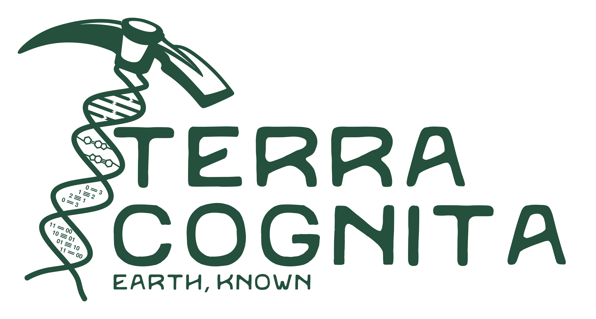

<picture>
  <source media="(prefers-color-scheme: dark)" srcset="lockup_taupe.svg">
  
</picture>

Terra Cognita LLC is a consulting firm in Pittsburgh, Pennsylvania. We work in geochemistry, microbiology and data science for mining, water treatment and research.

Our services cover four areas.

| Area | Work |
|---|---|
| Field, mining and geochemistry | Water chemistry models, leach tests and critical-mineral recovery, environmental microbiology, field sampling |
| Industrial and engineered systems | Experimental and pilot-scale design, treatment and process design, investigations of process failures, biological and economic risk assessment |
| Data science | Statistics and machine learning, study design, figures, maps and reports |
| Coding and dashboards | Data science code for any discipline, dashboards, web tools and calculators, data pipelines with a record of each run |

Website and contact form: [terracognita.earth](https://terracognita.earth)
